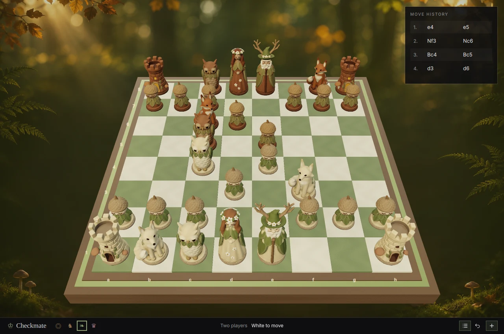
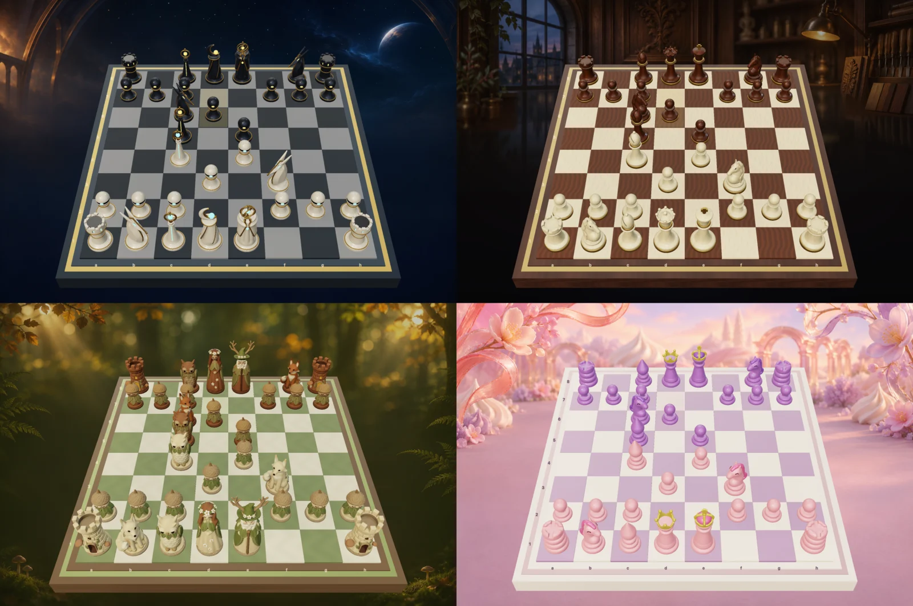

# Checkmate



3D chess for Omarchy. Play a friend on the same computer or the built-in opponent, on four original sculpted sets. Built with C++ and Qt Quick 3D, following Omarchy's theme and language.



Every set moves in its own manner. Orbital Orders hovers, banks into a glide and scans when chosen. Midnight Atelier is handled under flickering candlelight and tipped over when taken. Moss & Myth breathes, turns to watch a neighbour being picked, and leaps. Candy Kingdom wobbles like jelly and pops.

## Play

Click a piece, then a highlighted square. Right-drag to orbit the board and scroll to zoom. New game offers two players or the computer at three levels, as either color. Games have no clock and save after every move, and all the rules are in, draws by repetition and the fifty-move rule included.

| Key | Action |
| --- | --- |
| Arrow keys | Navigate squares |
| Space / Enter | Select or move |
| Escape | Cancel selection |
| Ctrl+Z | Undo |
| N | New game |
| F | Flip board |
| R | Reset camera |
| 1–4 | Switch piece set |
| B | Show or hide the moves |
| Tab | Show or hide the interface |
| ? | Show shortcuts |
| Q | Quit |

## Command line

These need no display and leave the saved game alone. Each takes `--json`.

```bash
checkmate inspect          # FEN, moves and result of the saved game
checkmate export > game.pgn
checkmate legal [FEN]      # legal moves, from the start or a position
```

## Build

Needs CMake, a C++17 compiler and Qt 6 with Quick 3D. On Omarchy, `bin/build` installs whatever is missing.

```bash
bin/build
bin/test
build/checkmate open
```

## License

MIT.
