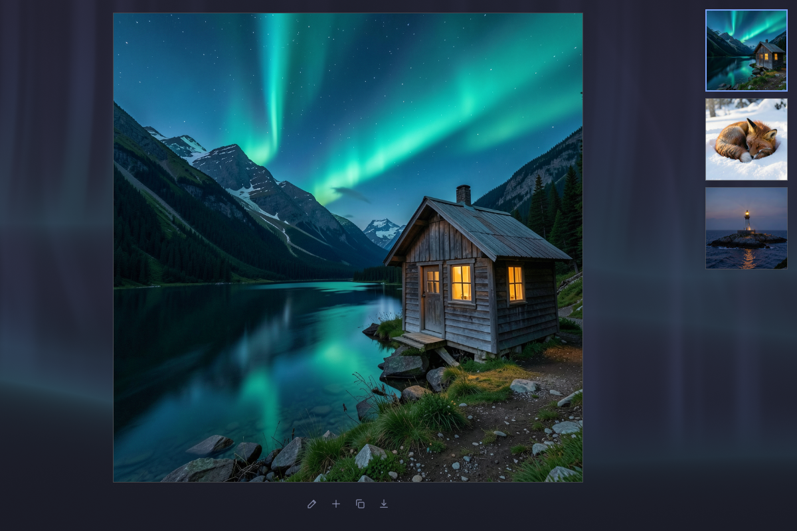

# Fantasi

Make images, video clips and songs on your own machine with Omarchy's local AI models.



Describe an image and watch it come to life. Change it by saying what should change, start from a picture of your own, or combine up to four. The model you pick decides what you make: hover its mark to pick another. A video model makes a clip with sound, from a prompt or from a picture, as long as your machine has the memory for: 2, 5 or 10 seconds, or up to the 15 MiniMax H3 is made for. A music model makes a song from a description and lyrics, yours or its own.

Images and clips are kept in `~/Pictures/Generated` with their prompts, songs in `~/Music/Generated`. The models run in [omarchy-local-ai](https://github.com/omacom/omarchy-local-ai), and Fantasi offers to start or set one up when none is running.

## Shortcuts

| Keys | Action |
| --- | --- |
| Enter | Make it |
| Esc | Stop, or go back |
| Ctrl+E | Change it |
| Ctrl+N | New generation |
| Ctrl+O | Add a picture |
| Ctrl+1, 2, 3 | Screen, square or portrait |
| Ctrl+B | Show or hide the history |
| F1 | All shortcuts |

## Command line

```sh
fantasi generate "a calm lake at dusk"
fantasi generate "make it night" --from lake.png
fantasi generate --video "the mist lifts off the lake" --from lake.png
fantasi generate --music "warm synthwave with a male vocal" --lyrics "[verse]\nTyping at midnight\n[chorus]\nTake me home"
fantasi skill install    # teach your coding agents to make images
```

## License

MIT.
