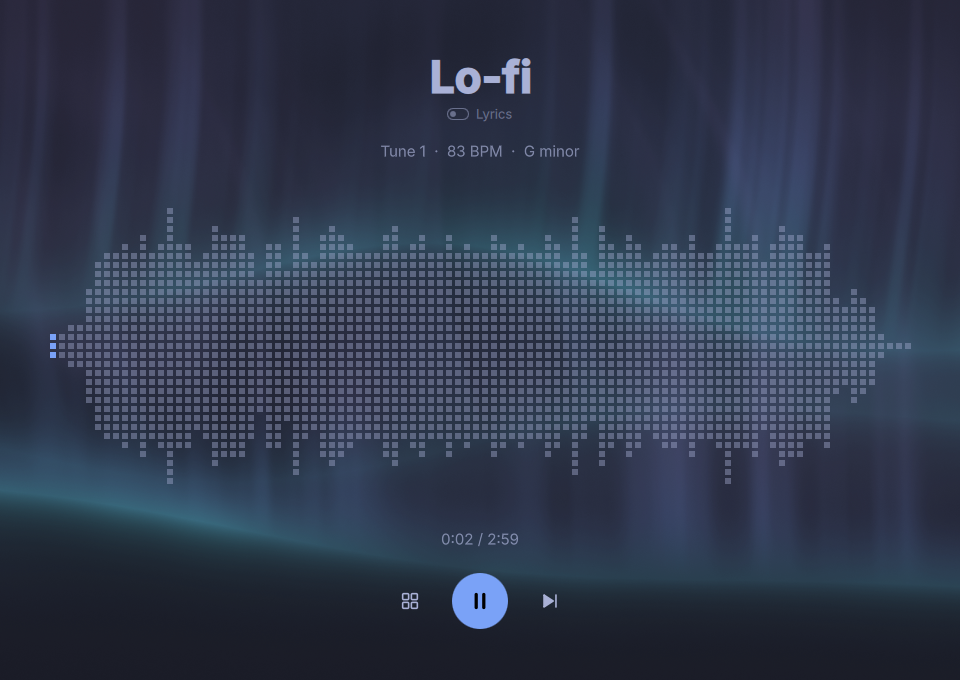

# Flowtunes

Endless music in the genre you pick, made on your own machine with Omarchy's local music model.



Pick a genre and the music never stops. The model makes one tune after another, each a little different from the last, and always has the next two ready behind the one playing, so a skip never waits. Lo-fi, Ambient, Synthwave, Deep House, Techno, Drum & Bass, Jazz, Classical, Downtempo, Post-Rock, Acoustic and Cinematic are there to flow to. Turn the lyrics on and the tunes are sung, with words the model writes in your language; leave them off for music alone.

Every tune has a name: a sung one is named for its hook, the line it sings most, and one nobody sings in gets two words of its genre, like Dusty Notebook or Neon Boulevard. The name is kept in the MP3's tag, and the tune in a folder of its genre in your music, like `~/Music/Deep House`, named for when it was made, its tempo and its key, and ending in `-instrumental` when nobody sings in it. A genre that has tunes from before plays those first, in a new order each time, before the model makes more, and any MP3 of your own in the folder plays along. The model runs in [omarchy-local-ai](https://github.com/omacom/omarchy-local-ai), and Flowtunes starts it, or offers to set it up, when it isn't running.

## Shortcuts

| Keys | Action |
| --- | --- |
| Arrows | Move between the genres |
| Enter | Play the genre |
| Space | Pause or play |
| N | Skip to the next tune |
| L | Turn the lyrics on or off |
| G | Pick another genre |
| ? | All shortcuts |
| Q | Quit |

The media keys play, pause and skip too, as does anything else that speaks MPRIS, like `playerctl`, and the bar shows the tune that's playing. Previous starts the tune over.

## Command line

```sh
flowtunes            # pick a genre
flowtunes jazz       # start playing one right away
```

## License

MIT.
