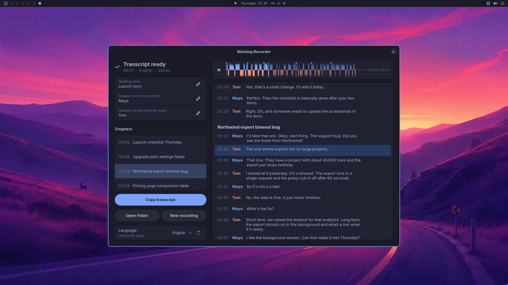

# Meeting Recorder (Omaxian port)

Standalone GTK 4 / libadwaita meeting recorder for Omaxian. Records microphone
and computer audio as two tracks, transcribes locally with whisper.cpp, and
optionally shows a live waveform on the bar.

Port of [jankeesvw/omarchy-meeting-recorder](https://github.com/jankeesvw/omarchy-meeting-recorder)
(upstream `v1.8.0`, commit pinned in `.omaxian-upstream-commit`). Full upstream
docs: [`README.upstream.md`](README.upstream.md).

This is a **standalone app**, not a Quickshell community plugin. It lives under
`community-apps/` so `./scripts/deploy.sh` never copies it into `$HOME`.



## Omaxian deltas

| Upstream (Omarchy / Hyprland) | This port |
| ----------------------------- | --------- |
| `yay` / pacman / AUR `install.sh` | Debian `install.sh` → `~/.local` + apt deps |
| Arch rustc / pacman Rust | **rustup** (`rust-toolchain.toml` → stable); Debian `rustc` is too old for gtk4-rs |
| Hyprland float window rules | i3 `for_window` snippet (`omaxian/i3-meeting-recorder.conf`) |
| First-run bar offer via `omarchy` + `omarchy plugin enable` | `omarchy-shell` / `omarchy-plugin-enable`; plugin under `~/.local/share/…` or `/usr/share/…` |
| Compact resize via `hyprctl` | Unchanged; already gated on `HYPRLAND_INSTANCE_SIGNATURE` (GTK resize on i3) |

Audio capture (`parec` / `pacat`), theme follow (`colors.toml`), chapters
(`omarchy-default-agent`), webcam (v4l2), and IPC (`watch`) are unchanged and
already X11 / Pulse-compatible.

## Requirements

Runtime (also in `omaxian.deps.json`):

- `libgtk-4-1`, `libadwaita-1-0` (≥ 1.6)
- `pulseaudio-utils` (`parec`, `pacat` — works with pipewire-pulse too)
- `ffmpeg`
- `libvulkan1` (optional GPU transcription; CPU fallback works)

Build: **rustup** (stable ≥ 1.92; `install.sh` installs it), CMake, OpenSSL
(`libssl-dev`), GTK4 / Adwaita / Pulse / Vulkan headers, `glslc` (skip Vulkan
pieces with `./install.sh --cpu-only`). Do not use Debian `apt install rustc cargo`.

## Install

From the Omaxian repo root (or this directory):

```bash
community-apps/omarchy-meeting-recorder/install.sh
# or CPU-only whisper:
community-apps/omarchy-meeting-recorder/install.sh --cpu-only
```

That installs:

| Path | Role |
| ---- | ---- |
| `~/.local/bin/omarchy-meeting-recorder` | app |
| `~/.local/share/applications/omarchy-meeting-recorder.desktop` | launcher |
| `~/.local/share/omarchy-meeting-recorder/plugin/` | optional bar widget |
| `~/.config/i3/config.d/90_meeting-recorder.conf` | float rule (if missing) |

Then `i3-msg reload` if the float rule was just added. Open **Meeting Recorder**
from the launcher.

### Optional bar widget (manual)

If you declined the first-run offer:

```bash
ln -sfn ~/.local/share/omarchy-meeting-recorder/plugin \
  ~/.config/omarchy/plugins/jankeesvw.meeting-recorder
omarchy-shell shell rescanPlugins
omarchy-plugin-enable jankeesvw.meeting-recorder --section right
```

### Optional keybinds

```
bindsym $mod+Shift+m exec --no-startup-id omarchy-meeting-recorder
bindsym $mod+Ctrl+m  exec --no-startup-id omarchy-meeting-recorder start
```

## Smoke check

1. Launch the app — both meters should move (mic + monitor of default sink).
2. Start / stop a short recording; wait for transcription (first run downloads ~1.6 GB model).
3. Switch theme (`omarchy-theme-set …`) — window colours should follow.
4. With a default agent set, a ≥3 min meeting gets chapters.

Do **not** run `omarchy-restart-shell` from an agent session to enable the bar
widget; use the commands above, then log out/in if the shell never saw the
plugin.

## Uninstall

```bash
rm -f ~/.local/bin/omarchy-meeting-recorder
rm -f ~/.local/share/applications/omarchy-meeting-recorder.desktop
rm -f ~/.local/share/mime/packages/omarchy-meeting-recorder.xml
rm -rf ~/.local/share/omarchy-meeting-recorder
rm -f ~/.config/i3/config.d/90_meeting-recorder.conf
# optional bar widget:
omarchy-plugin-remove jankeesvw.meeting-recorder 2>/dev/null || true
rm -f ~/.config/omarchy/plugins/jankeesvw.meeting-recorder
```

Meetings under `~/Documents/Meetings` and models under
`~/.local/share/omarchy-meeting-recorder/models/` are left alone.

## License

MIT (upstream).
