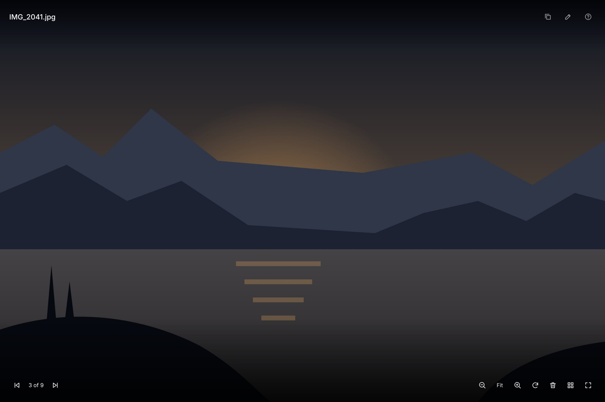
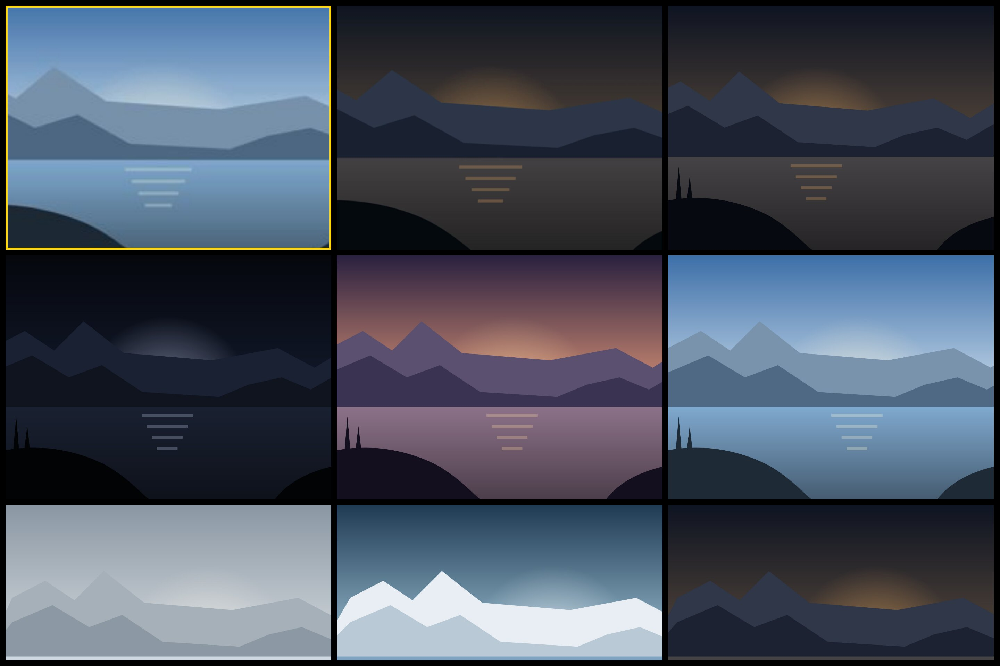
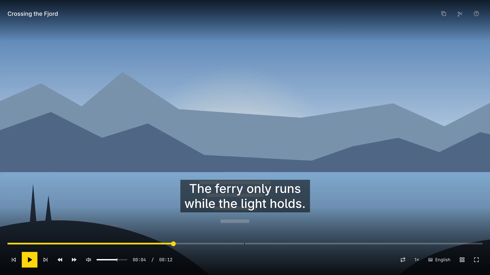
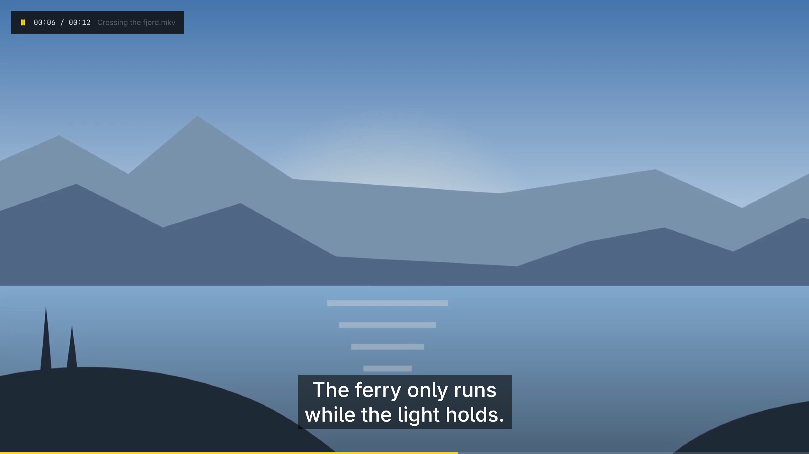
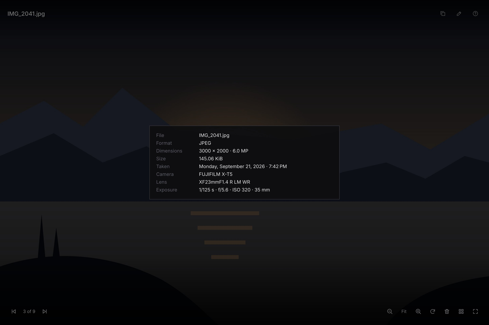

# Omaview

Omarchy's picture viewer and media player, listed in the launcher as Media Viewer. Open a photo, a video or a song, or a whole folder, and look at it: the controls along the bottom and the title across the top, or nothing but the picture once Tab puts them away. Step through a folder with the arrows, zoom with the wheel, and watch the clips between the photos in the same window.

Ctrl+M, or opening a folder, shows everything in it as a grid. Pictures fill in as they decode, and the video under the pointer flips through frames from across the whole of it, silently, so you can tell one clip from the next before opening any.

Videos and songs get a timeline with preview frames and chapter ticks, subtitles and audio tracks by language, speed, loop (R), and a volume that goes on to 150% for quiet recordings. Where you stopped in anything long is remembered.

With the controls put away, only the picture is left, and a corner says where you are for a moment whenever something changes. The volume, the speed, and what came of a copy, a save or a print show a moment in the middle.

I shows what's in the file: the streams and chapters of a video, or what the camera wrote for a photo.

Pictures are decoded by Qt's image plugins, off the main thread: JPEG, PNG, WebP, GIF and animated WebP, TIFF, BMP and SVG, and HEIC, AVIF and JPEG XL when `kimageformats` is installed. They're turned upright by their EXIF orientation, and the info card shows what the camera wrote. Opening a picture never starts the video engine, so it's up at once.

Videos play through ffmpeg: Qt Multimedia's FFmpeg backend decodes, on the GPU where it can, and the `ffmpeg` and `ffprobe` tools read chapters and track details, make the scrub previews, read subtitles, and grab exact frames.

## Command line

`omaview photo.jpg` (or `omaview open photo.jpg`) opens a file with the others in its folder to step through. A photo's folder brings its pictures and videos, a song's its songs and videos, and a video's everything, but songs and pictures never mix: an album doesn't show its cover as a track. Several files given at once are the playlist, in that order. A folder (`omaview ~/Pictures`) opens as the grid of its pictures and videos, or of its songs and videos when it holds more songs than pictures, as an album with its cover does.

These need no display, take `--json`, and exit 0 or 1 with the reason on stderr:

- `omaview info <file>` — a video's duration, streams, chapters and where Omaview would resume, or a picture's size, format and camera details.
- `omaview frame <file> --at 1:02:03 -o still.png` — the exact frame at a time.
- `omaview skill install` — installs a short skill for coding agents.

## Shortcuts

The keys mean what fits what's shown: the arrows step through pictures and seek in a video.

### Pictures

| Key | Action |
|---|---|
| `←` `→` `PgUp` `PgDn` | Previous or next file |
| `Home` `End` | First or last file |
| `+` `−` / wheel / pinch | Zoom in or out, about the pointer |
| `0` / `1` | Fit to the window / actual size |
| `←` `→` `↑` `↓` / drag | Move around, zoomed in |
| `R` `Shift+R` | Turn right or left (the file isn't changed) |
| `Space` | Pause or play an animation |
| `Ctrl+P` | Print, to the default printer |
| `E` | Edit in Omasnap |

### Videos and music

| Key | Action |
|---|---|
| `Space` | Play or pause |
| `←` `→` / `Shift+←` `→` | Back or forward 5 seconds / 1 second |
| `0`–`9` / `Home` | Jump to that tenth of the way / back to the start |
| `,` `.` | Step one frame back or forward |
| `PgUp` `PgDn` | Previous or next chapter |
| `[` `]` / `Backspace` | Slower or faster / normal speed |
| `↑` `↓` / `M` | Louder or quieter, up to 150% / mute |
| `R` | Loop, or stop looping |
| `C` / `A` | Next subtitles, or off / next audio track |
| `Enter` | At the end of a file, play the next one |
| `Ctrl+S` | Save the frame as a PNG |
| `E` | Trim in Omacut |

Click the picture to play or pause, double-click it for fullscreen, and scroll for volume. The bottom edge grows into a timeline with preview frames when the pointer comes near it.

### Any file

| Key | Action |
|---|---|
| `N` `P` | Next or previous file |
| `Ctrl+M` | Every file in the folder as a grid; the video under the pointer flips through frames from across it |
| `Ctrl++` `Ctrl+−` | Bigger or smaller tiles in the grid |
| `Tab` | Show or hide the controls |
| `F` / `Esc` | Fullscreen / leave fullscreen or hide the controls |
| `I` | What's in the file: streams and chapters, or the camera's details |
| `Ctrl+C` | Copy the picture as it shows, or the video's frame |
| `Delete` / `Ctrl+Z` | Move to the Trash and show the next / bring it back |
| `Ctrl+O` | Open files |
| `?` | Every shortcut |
| `Q` | Quit |

## What it remembers

Where you stopped in anything longer than five minutes, so it resumes there (Home starts over), and forgets once you reach the end. The volume, and the subtitle and audio languages you last picked. They live in `~/.local/state/omaview/positions.json`, keyed by a hash of each file's path, size and time, so the file holds no names.

Subtitles start off unless the film speaks a language other than yours and has subtitles in yours. Files beside the video named after it (`movie.srt`, `movie.en.srt`, `.vtt`, `.ass`) are offered too. Bitmap subtitle tracks (PGS, VobSub) aren't shown, and the info card says so.

While a video plays, Omaview keeps the screen from going to sleep. Once a video or song has played, media keys, `playerctl` and the bar's now-playing reach it through MPRIS; a window showing only pictures stays out of their way.

A picture edited in another app while it's shown, in Omasnap say, is shown again as it was saved.

Omaview speaks the language picked under Omarchy's Setup > Language, follows the theme, and mirrors for right-to-left languages.

## Requirements

- Qt 6 with Multimedia: `qt6-base`, `qt6-declarative`, `qt6-multimedia` and `qt6-multimedia-ffmpeg`, `qt6-svg`, `qt6-wayland`
- `qt6-imageformats` for WebP and TIFF, and `kimageformats` for HEIC, AVIF and JPEG XL
- `cups` for printing (`lp`), optional
- `ffmpeg`, for `ffprobe` and `ffmpeg`
- `wl-clipboard`, so a copied frame outlives Omaview
- PipeWire with WirePlumber (`pw-dump`, `wpctl`) for volume above 100%, optional
- `xdg-desktop-portal` and a backend, for the open and save dialogs
- To build: `cmake`, `wayland-protocols`

## Development

`bin/build` builds into `build/`, and `bin/test` builds and runs every test offscreen: the backend against clips and pictures made at test time, the real window driven by keys, and the command line as an agent uses it. `cmake --install build --prefix ~/.local` puts Omaview in the launcher before it is packaged. `QT_QPA_PLATFORM=offscreen QT_SCALE_FACTOR=2 OMAVIEW_README_SHOTS=<dir> build/ui_tests readmeScreenshots` shoots the screenshots above, of a made-up fjord, in the real window.

## License

MIT.
