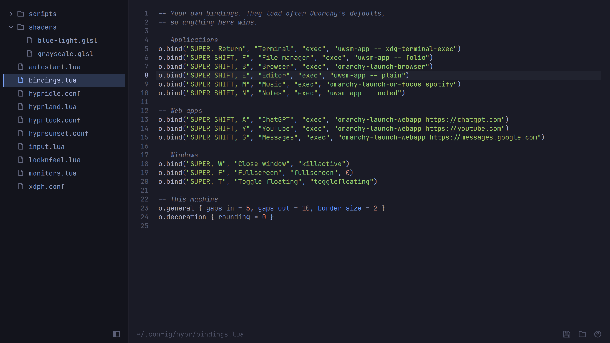
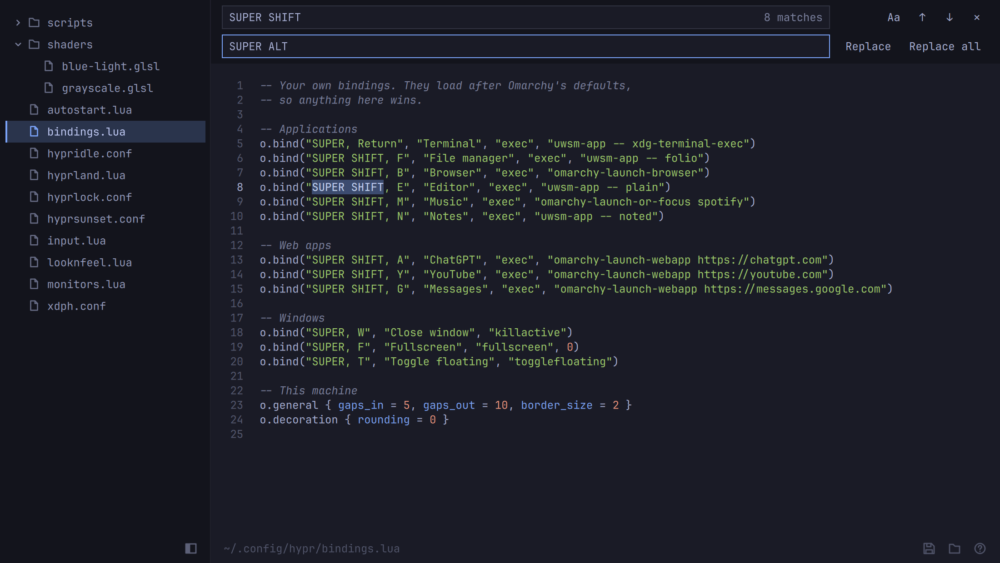
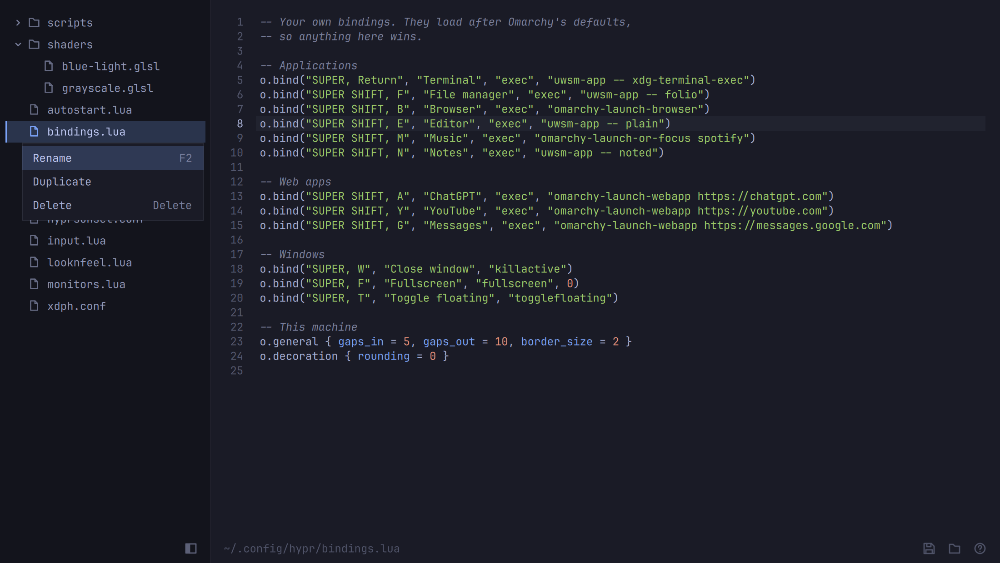
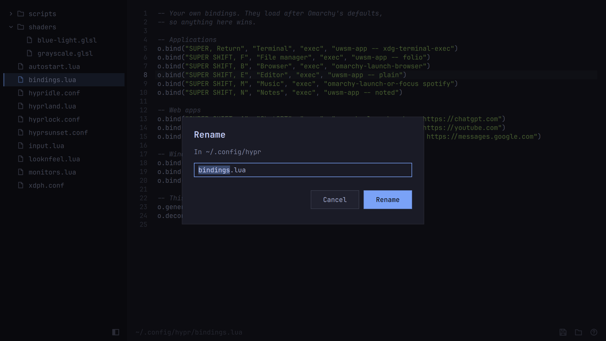
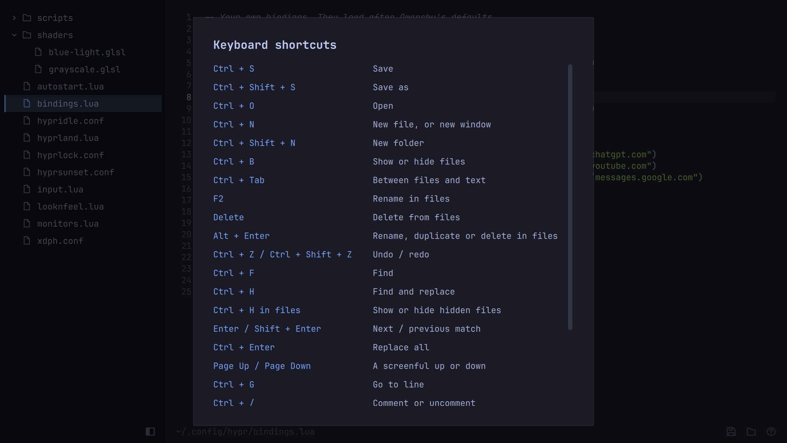

# Plain



Plain is Omarchy's text editor for config files: the editor you don't have to learn. Ctrl+S saves, Ctrl+Z undoes, Ctrl+F finds, and the window closes like any other. It follows Omarchy's theme, font and language, colors Lua, hyprlang/INI, TOML, JSON, YAML, shell and CSS in the theme's palette, and keeps to one window and one file, with the folder's files beside it when you want them.

<table>
  <tr>
    <td></td>
    <td></td>
  </tr>
  <tr>
    <td></td>
    <td></td>
  </tr>
</table>

## Careful with files

A config file is read by a program that won't forgive a surprise, so Plain:

- **Saves atomically**, through a temporary file and a rename: a crash mid-save leaves the old file whole.
- **Never saves over a version you haven't seen.** It checks the file right before every save and asks if something else changed or deleted it.
- **Follows symlinks**, so linked configs stay linked, and asks if a link starts pointing somewhere else.
- **Gives back the same bytes** when you save without edits: line endings, byte-order mark and final newline as they were. The one exception, a file that mixes line endings, is pointed out when it opens.
- **Asks before writing in place** when replacing the file would lose hard links, its owner, special permission bits or extended attributes.
- **Opens only UTF-8 text**, so nothing is saved back damaged. Files that belong to root open read-only; edit them with `sudoedit`.

## Use

```sh
plain ~/.config/hypr/bindings.lua
plain +42 /etc/pacman.conf     # at line 42
plain ~/.config/hypr           # a folder, with its files beside the text
EDITOR=plain git commit        # waits until the window closes
```

Plain runs in the foreground until its window closes, so it works as `$EDITOR`, `$VISUAL` and `$SUDO_EDITOR`.

## Files

Ctrl+B shows the files of the open file's folder, with the keys in them, and hides them again; opening Plain on a folder starts with them shown. Ctrl+Tab moves between the files and the text.

In the files, Enter opens a file, asking first about unsaved changes. F2 renames, Delete moves to the trash after asking, and right-click or Alt+Enter offers Rename, Duplicate and Delete. Ctrl+N and Ctrl+Shift+N make a new file or folder, and dragging onto a folder moves there; the open file follows a rename or move, edits and all. Ctrl+H shows hidden files, which show from the start inside a hidden folder like `~/.config/hypr`.

## Keyboard

| Key | Action |
| --- | --- |
| Ctrl+S / Ctrl+Shift+S | Save / save as |
| Ctrl+O / Ctrl+W | Open / close |
| Ctrl+N | New file in the files, or a new window without them |
| Ctrl+Z / Ctrl+Shift+Z | Undo / redo |
| Ctrl+F / Ctrl+H | Find / find and replace, again to close |
| Enter / Shift+Enter, F3 / Shift+F3 | Next / previous match |
| Ctrl+G | Go to line |
| Page Up / Page Down | A screenful, with Shift selecting |
| Ctrl+/ | Comment or uncomment |
| Tab / Shift+Tab | Indent / outdent |
| Alt+Z | Word wrap |
| Ctrl+Plus / Ctrl+Minus / Ctrl+0 | Text size |
| Ctrl+B / Ctrl+Tab | Show or hide the files / move between files and text |
| F1 | Every shortcut |

Text starts at the desktop's text size and follows it. The size you set with Ctrl+Plus and Ctrl+Minus and word wrap, on to start with, are remembered in `~/.config/plain/settings.conf`. Nothing else is a setting.

## Install

Omarchy installs Plain as the `plain` package: `omarchy-pkg-add plain`.

## Build

Plain is C++ and Qt Quick, built with CMake.

```sh
bin/build      # build/plain
bin/test       # the tests, offscreen
```

## License

MIT.
