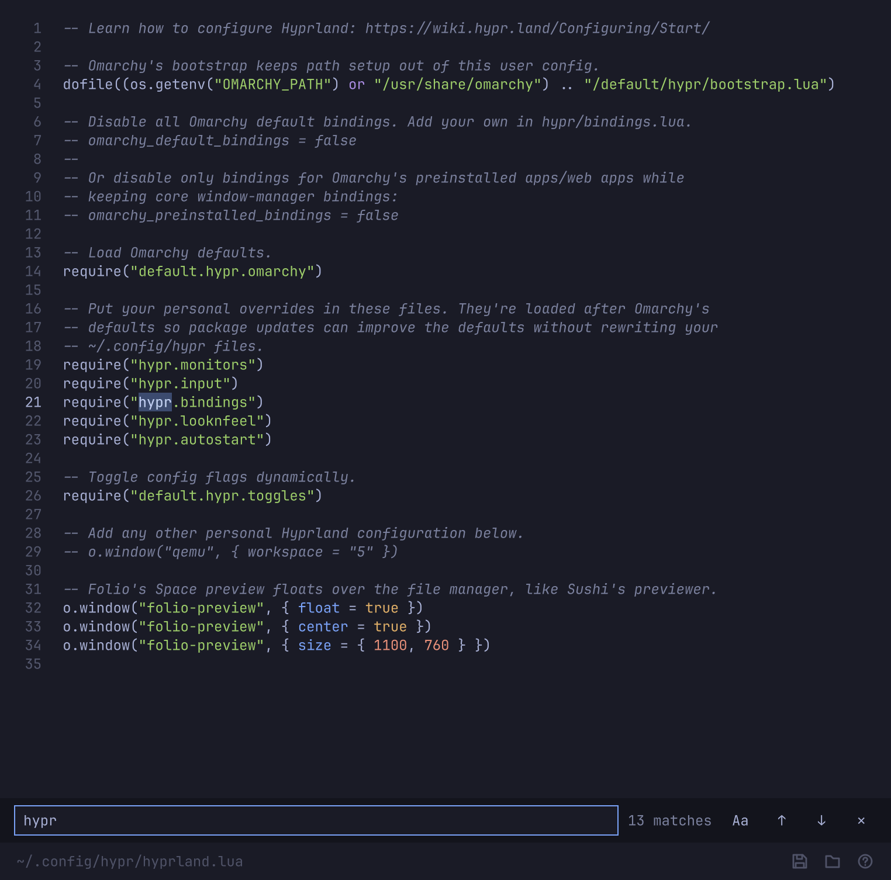

# Plain



Plain is Omarchy's text editor for config files: the editor you don't have to learn. Ctrl+S saves, Ctrl+Z undoes, Ctrl+F finds, and the window closes like any other. It follows the Omarchy theme, font and language, colors Lua, hyprlang/INI, TOML, JSON, YAML, shell and CSS with the theme's own palette, and does nothing else: one window, one file, no tabs, plugins or projects.

It's careful with files, because a config file is read by a program that won't forgive a surprise:

- **Saves atomically**, through a temporary file and a rename, so a crash mid-save leaves the old file whole.
- **Follows symlinks** and saves to their target, so linked configs stay linked. If a link starts pointing somewhere else while the file is open, Plain asks before saving.
- **Keeps what the file had**: LF or CRLF line endings, a UTF-8 byte-order mark, and exactly the final newline you see. Opening and saving without edits gives back the same bytes.
- **Never saves over a version you haven't seen.** Right before every save it checks the file on disk; if something else changed or deleted it, Plain asks.
- **Asks before writing in place** when replacing the file would lose something: other hard links, another owner, special permission bits, extended attributes, or a folder you can't write to.
- **Opens only text.** A file that isn't valid UTF-8 isn't opened at all, so it can't be saved back damaged.

Files that belong to root are opened read-only, with the way to edit them: `sudoedit`, which Plain works with as `$SUDO_EDITOR`.

## Use

```sh
plain ~/.config/hypr/bindings.lua
plain +42 /etc/pacman.conf     # open at line 42
EDITOR=plain git commit         # waits until the window closes
```

Plain runs in the foreground and exits when its window closes, so it works as `$EDITOR`, `$VISUAL` and `$SUDO_EDITOR`. It opens one file at a time.

## Keyboard

| Key | Action |
| --- | --- |
| Ctrl+S | Save |
| Ctrl+Shift+S | Save as |
| Ctrl+O | Open |
| Ctrl+Z / Ctrl+Shift+Z | Undo / redo |
| Ctrl+F | Find |
| Ctrl+H | Find and replace |
| Enter / Shift+Enter | Next / previous match |
| Ctrl+G | Go to line |
| Ctrl+/ | Comment or uncomment |
| Tab / Shift+Tab | Indent / outdent |
| Alt+Z | Word wrap |
| Ctrl+Plus / Ctrl+Minus / Ctrl+0 | Text size |
| Ctrl+W | Close |
| F1 | Every shortcut |

Text starts at the desktop's text size, the one Omarchy's display panel sets (12px, the terminals' 9pt), and follows it when it changes. Ctrl+Plus and Ctrl+Minus adjust from there, and that adjustment and word wrap are remembered in `~/.config/plain/settings.conf`. Nothing else is a setting.

## Install

Omarchy installs Plain as the `plain` package from its package repository (`omarchy-pkg-add plain`).

## Build

Plain is C++ and Qt Quick, built with CMake.

```sh
bin/build      # build/plain
bin/test       # the test suite, offscreen
```

## License

MIT.
