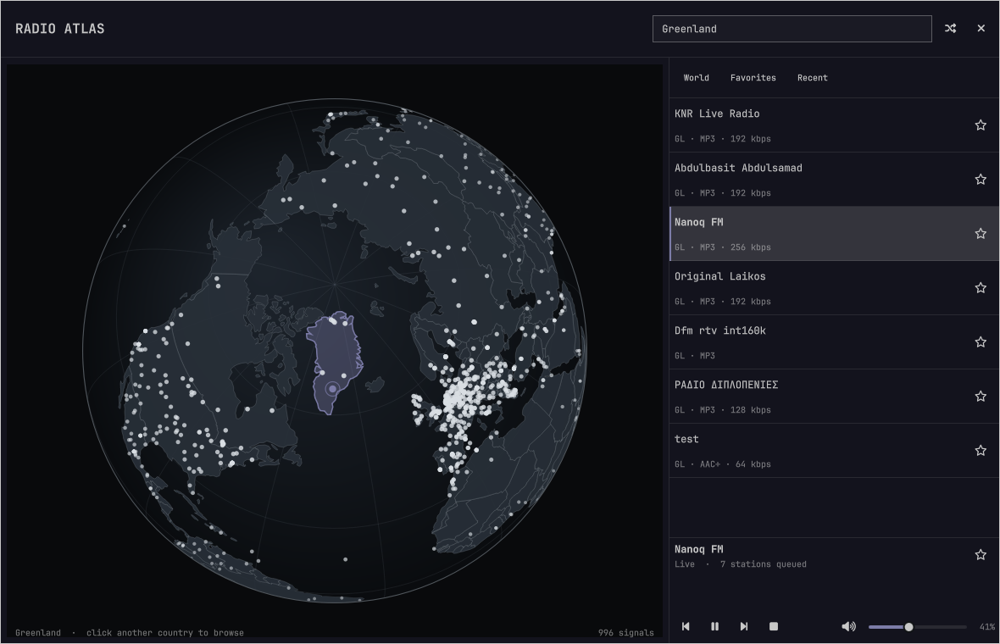

# Radio Atlas (Omaxian port)

Explore live radio on a rotatable globe from the Omaxian bar. Click a station
signal to play it, or click a country to browse its stations. Playback runs in
`mpv`, with a dedicated MPRIS bridge so `omarchy.media` provides the usual play,
pause, previous, and next controls.

Port of [AksharP5/omarchy-radio-atlas](https://github.com/AksharP5/omarchy-radio-atlas)
(upstream commit `cb604f7`, version 0.1.9). Upstream won the
[first Omarchy plugin competition](https://omarchy.org/news/2026/08/the-first-plugin-competition-winners/).

Plugin id: `akshar.radio-atlas` (unchanged). Optional — not installed by
`./deploy.sh`. See [`../README.md`](../README.md) for the catalog install
pattern.



## Omaxian deltas

| Upstream (Omarchy) | This port |
| ----------------------------- | --------- |
| Compositor monitor IPC + refresh | `Quickshell.I3` (`focusedMonitor` / `monitorFor`); no refresh call |
| Dynamic Lua window_rule before map | No-op sizing handshake; float/center via i3 `for_window` |
| Attached window opacity fade-in | Dropped (`FloatingWindow` has no `opacity` here; maps immediately) |
| Screensaver dismiss via compositor window events | Dropped (Omaxian uses `xss-lock` / `i3lock`, not a QS screensaver surface) |
| Wayland clipboard CLI for track copy | `xclip` (fallback `xsel`) |
| mpv `--audio-device=pipewire/<sink>` only | `pipewire/` or `pulse/` chosen from available mpv AOs |
| Arch / session-manager / user-unit docs | Debian apt deps below |

Stock i3 ships a matching rule in `omaxian/.config/i3/config.d/05_rules.conf`
(`title="^Radio Atlas$"`). After deploy, `i3-msg reload` picks it up.

## Requirements

| Package | For |
| --- | --- |
| `mpv`, `socat`, `jq`, `bubblewrap`, `curl`, `iproute2`, `file` | player, fetch sandbox, status |
| `python3`, `python3-dbus`, `python3-gi` | MPRIS bridge + helpers |
| `pulseaudio-utils` (or PipeWire pulse compat providing `pactl`) | output list / sink names |
| `xclip` (or `xsel`) | copy track metadata |

```bash
sudo apt install bubblewrap curl iproute2 jq mpv python3 python3-dbus python3-gi \
  socat file xclip pulseaudio-utils
```

## Install

From the Omaxian repo root:

```bash
PLUGIN=community-plugins/akshar.radio-atlas
ID=$(jq -r .id "$PLUGIN/manifest.json")

omarchy-plugin-check "$PLUGIN"
omarchy-plugin-validate "$PLUGIN"

mkdir -p ~/.config/omarchy/plugins
rsync -a --delete -- "$PLUGIN/" "$HOME/.config/omarchy/plugins/$ID/"

omarchy-shell shell rescanPlugins
omarchy-plugin-enable "$ID"
```

Or: `./scripts/install-community-plugins.sh akshar.radio-atlas`

A Radio Atlas icon appears on the bar (Media category). Move it in Settings →
Bar. Open with a left click, or:

```
bindsym $mod+Mod1+r exec --no-startup-id omarchy-shell shell toggle akshar.radio-atlas
```

### Update

```bash
omarchy-plugin-update "$ID" --from "$PLUGIN"
```

### Remove

Stop the independent radio player before removing the plugin:

```bash
~/.config/omarchy/plugins/akshar.radio-atlas/radio-player stop
omarchy-plugin-remove akshar.radio-atlas
```

Favorites, listening history, volume, and the selected audio output remain in
`~/.local/share/radio-atlas/state.json` so reinstalling restores them. Remove
`~/.local/share/radio-atlas/` manually if you also want to delete that data.

## Controls

| Input | Action |
| --- | --- |
| Drag or flick globe | Rotate; a flick coasts and highlights a nearby station |
| Wheel over globe | Zoom |
| Globe + / − buttons | Zoom |
| Click signal | Play station |
| Click country | Browse country |
| `/` | Focus search |
| Up / Down | Move through stations |
| Enter | Play selected station |
| Space | Play or pause |
| `R` | Tune a random station |
| `F` | Favorite selected station |
| `+` / `-` | Raise or lower radio volume |
| `M` | Mute or unmute |
| Speaker icon | Choose the audio output |
| Tab / Shift+Tab, then Enter or Space | Navigate and activate controls |
| `?` | Show or hide controls |
| Escape | Dismiss the output menu, hide controls, clear search, or close |

On the bar: left click opens Radio Atlas, middle click tunes randomly, right
click stops or resumes the most recently played station, mouse wheel adjusts
radio volume.

The window fits the focused display's logical size each time it opens. Close and
reopen after moving to a smaller display to fit that output.

## Audio outputs

The speaker menu lists `pactl` sinks and routes mpv to the matching
`pipewire/<name>` or `pulse/<name>` device. System default leaves
`--audio-device=auto`. AirPlay/RAOP sinks appear when your PipeWire (or
compatible) stack exposes them as Pulse sinks.

## License

MIT — see [LICENSE](LICENSE).
