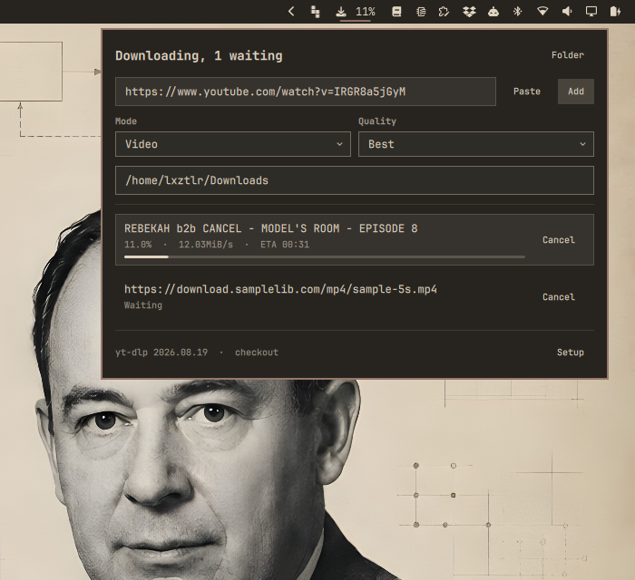

# yt-dlp queue (Omaxian port)

A download queue for yt-dlp in the Omaxian bar. Paste a link, pick video or
audio, and watch the queue work through it.

Port of
[AlexZeitler/omarchy-yt-dlp-plugin](https://github.com/AlexZeitler/omarchy-yt-dlp-plugin)
(upstream commit `8679380`, version 0.2.1).

Plugin id: `alexzeitler.ytdlp` (unchanged). Optional — not installed by
`./deploy.sh`. See [`../README.md`](../README.md) for the catalog install
pattern.



## Omaxian deltas

| Upstream (Omarchy / Wayland) | This port |
| ---------------------------- | --------- |
| Wayland clipboard paste CLI for link fill | `xclip -selection clipboard -o` (fallback `xsel -b -o`) |
| `omarchy-launch-tui` for checkout sync | `omarchy-launch-floating-terminal-with-presentation` |
| Bar icon FA `U+F019` (BMP PUA) | Nerd Font `md-download` `U+F01DA` — Arial from `msttcorefonts` steals `F019` and corrupts the glyph |
| Arch package / Omarchy bundled deps | Debian/Devuan `apt` packages below |
| `omarchy plugin add` / `omarchy restart shell` | Local rsync install; log out / in after first enable |

`FolderField.qml`, `ytdlp-queue`, and the rest of the panel are unchanged aside
from a comment that distro packages (not only Arch) lag upstream yt-dlp.

## Requirements

| Package / tool | For |
| --- | --- |
| `yt-dlp` | Fallback binary when no reviewed checkout is present |
| `ffmpeg` | Audio re-encode and mux |
| `jq`, `git`, `flock` (`util-linux`) | Queue state, checkout, worker lock |
| `xdg-user-dir` (`xdg-user-dirs`) | Default download folder |
| `xclip` (or `xsel`) | Clipboard → link field |
| `xdg-utils` | Open destination folder / release URLs |

```bash
sudo apt install yt-dlp ffmpeg jq git util-linux xdg-user-dirs xclip xdg-utils
```

## Install

From the Omaxian repo root:

```bash
PLUGIN=community-plugins/alexzeitler.ytdlp
ID=$(jq -r .id "$PLUGIN/manifest.json")

omarchy-plugin-check "$PLUGIN"
omarchy-plugin-validate "$PLUGIN"

mkdir -p ~/.config/omarchy/plugins
rsync -a --delete -- "$PLUGIN/" "$HOME/.config/omarchy/plugins/$ID/"

omarchy-shell shell rescanPlugins
omarchy-plugin-enable "$ID"
```

The bar icon lands in the right section by default. Move it in Settings → Bar.

After enabling a new plugin, **log out and back in** so Quickshell picks up the
tree cleanly (do not run `omarchy-restart-shell` from an agent session).

### Update

```bash
omarchy-plugin-update "$ID" --from "$PLUGIN"
```

### Remove

```bash
omarchy-plugin-remove alexzeitler.ytdlp
```

Queue state is left on purpose so a removal does not throw away history:

```bash
rm -rf "${XDG_STATE_HOME:-$HOME/.local/state}/omarchy-ytdlp"
```

Downloaded files are never touched.

## What it does

- Reads the clipboard when the panel opens and fills the link field if empty.
- Downloads video, or audio only. Video height can be capped at 1080p / 720p /
  480p. Audio container: keep original, or mp3 / m4a / opus / flac / wav.
- Queues every link. One download runs; the rest wait in order.
- Shows title, percentage, speed and ETA per job; bar shows the running %.
- Cancels a running download or drops a waiting one.
- Opens the target folder from the panel head or a finished job.
- Completes folder names while typing (Tab / Enter / Escape).
- Fetches and parks a reviewed yt-dlp git checkout (optional; package is fallback).

Mode, quality, audio format, target folder and checkout folder are kept in
`~/.config/omarchy/shell.json`.

## Which yt-dlp runs

A git checkout at the commit pinned in `omarchy/ytdlp-queue` wins over
`/usr/bin/yt-dlp`. Distro packages lag; YouTube breaks extractors often enough
that those weeks matter. The package stays as fallback.

`Setup` at the foot of the panel clones or repairs the checkout. Before every
run the worker checks HEAD, origin, and a clean tracked tree; otherwise it uses
the package. Raising the pin is an upstream plugin release; `Report` opens a
prepared issue on the [upstream repo](https://github.com/AlexZeitler/omarchy-yt-dlp-plugin).

## How the queue works

The widget never runs yt-dlp. It asks `omarchy/ytdlp-queue`, which owns the
queue on disk, so downloads survive a shell restart.

State under `${XDG_STATE_HOME:-~/.local/state}/omarchy-ytdlp/`:

```text
jobs/<id>.json        job: link, choices, status, title, error
jobs/<id>.progress    percentage, speed, ETA of the running download
logs/<id>.log         yt-dlp output that was not progress
worker.lock           one worker at a time
```

CLI (same script beside the QML):

```bash
ytdlp-queue add <url> [--mode video|audio] [--quality best|<height>]
                      [--audio-format keep|<format>] [--dest <dir>]
                      [--checkout <dir>]
ytdlp-queue list
ytdlp-queue cancel <id>
ytdlp-queue clear
ytdlp-queue default-dest
ytdlp-queue complete-dir <prefix>
ytdlp-queue checkout status [--dir <dir>]
ytdlp-queue checkout sync   [--dir <dir>]
ytdlp-queue binary [--dir <dir>]
```

## Things worth knowing

- For video, yt-dlp fetches video then audio streams; the bar % can walk
  backwards when the second stream starts — that is what yt-dlp reports.
- Playlist links download one video (`--no-playlist`).
- “Keep original” leaves the source audio container alone (often `.m4a`);
  other formats go through ffmpeg.
- A source without audio fails in audio mode; the panel shows the error.

## License

MIT — see [LICENSE](LICENSE).
