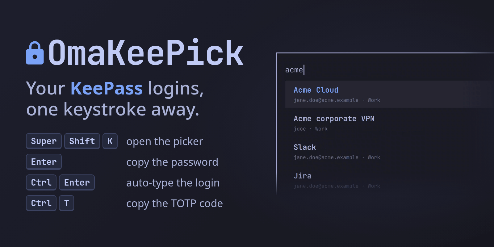

# OmaKeePick (Omaxian port)

A Listary-style KeePass picker for the Omaxian shell. Press a key, type a few
letters of an entry, and press Enter to copy its password, or Ctrl+Enter to
auto-type username, Tab and password into the window you were in. A padlock in
the bar shows whether the database is unlocked.

Port of [mirecad/omakeepick](https://github.com/mirecad/omakeepick) (upstream
commit `cdccd45`, version 0.1.1).

Plugin id: `mirecad.omakeepick` (unchanged). Optional — not installed by
`./deploy.sh`. See [`../README.md`](../README.md) for the catalog install
pattern.



- **One search box.** Fuzzy full-text search over title, username, URL, group
  path, tags and notes. Ignores case and diacritics; ranks recent / frequent
  entries first. Supports fzf syntax (`'exact`, `^prefix`, `suffix$`, `!exclude`).
- **Auto-type** with KeePass sequences (`{USERNAME}{TAB}{PASSWORD}{ENTER}` by
  default, or the sequence on the entry / group).
- **Copy** username, password, URL or current TOTP. Cleared after 15 seconds if
  still on the clipboard.
- **Quick unlock** with a short PIN after idle or screen lock (session only).
- **Read-only.** Never writes your `.kdbx`; KeePassXC (or anything else) edits it.

## Omaxian deltas

| Upstream (Omarchy / Wayland) | This port |
| ---------------------------- | --------- |
| Full-screen layer-shell overlay | Content-sized `PopupWindow` + 1px host (T1; no picom black-out); top edge pinned like upstream |
| Wayland virtual-keyboard auto-type | `xdotool` (`type --file -` for secrets on stdin) |
| Wayland clipboard CLI (`--sensitive`) | `xclip` (fallback `xsel`); no sensitive flag — timed clear is the history mitigation |
| Compositor XWayland paste branch | Dropped; always type with `xdotool` on X11 |
| Hyprland keybind / layer rule | i3 bind example below |
| Arch rust package helper | `sudo apt install cargo` (or download the pinned binary) |

Security contract is unchanged: **no secret ever enters QML**; field values go
daemon → `xdotool` / `xclip` only.

## Requirements

Omaxian with third-party shell plugins enabled, and:

| Package / tool | For |
| --- | --- |
| `xclip` (or `xsel`) | clipboard copy / clear |
| `xdotool` | auto-type |
| `cargo` / `rustc` | build `omakeepickd` from `daemon/` (required; upstream release binaries are Wayland-only) |

```bash
sudo apt install xclip xdotool cargo
```

A KeePass database in KDBX 3.1 or 4.x. KeePassXC itself is not required.

## Install

From the Omaxian repo root:

```bash
PLUGIN=community-plugins/mirecad.omakeepick
ID=$(jq -r .id "$PLUGIN/manifest.json")

omarchy-plugin-check "$PLUGIN"
omarchy-plugin-validate "$PLUGIN"

mkdir -p ~/.config/omarchy/plugins
rsync -a --delete -- "$PLUGIN/" "$HOME/.config/omarchy/plugins/$ID/"

omarchy-shell shell rescanPlugins
omarchy-plugin-enable "$ID"
```

Or via the helper / TUI (`./scripts/install-community-plugins.sh mirecad.omakeepick`).

On first open the plugin builds `omakeepickd` from `daemon/` with cargo
(upstream GitHub release binaries still call `wl-copy` / `wtype` and are not
used). To build the helper yourself:

```bash
~/.config/omarchy/plugins/mirecad.omakeepick/bin/install
```

### Update

```bash
omarchy-plugin-update "$ID" --from "$PLUGIN"
```

### Remove

```bash
omarchy-plugin-remove mirecad.omakeepick
pkill -x omakeepickd   # stop the helper; it locks and wipes the database first
```

Then delete any i3 keybinding you added. OmaKeePick never writes your database.
To also forget the last database path and usage counts, delete
`~/.local/state/omakeepick`. A from-source build leaves a cache in
`~/.cache/omakeepick`.

## Open it from the keyboard

The plugin does not bind a key on its own. i3 example (put in
`~/.config/i3/config.d/` or similar, then `i3-msg reload`):

```
bindsym $mod+Shift+k exec --no-startup-id omarchy-shell shell toggle mirecad.omakeepick
```

## Use

The first time, the picker shows an unlock card (database path, optional key
file, master password, optional PIN). Enter unlocks; Tab moves between fields.

Once open:

| Key | Action |
|---|---|
| typing | search |
| ↑ ↓ PgUp PgDn Home End | move the selection |
| **Enter** | copy the password (also double-click) |
| **Ctrl+Enter** | auto-type into the previously focused window |
| **Ctrl+Shift+Enter** | type only the password |
| **Ctrl+B** / **Ctrl+C** / **Ctrl+T** / **Ctrl+L** | copy username / password / TOTP / URL |
| Ctrl+U, Ctrl+Backspace | clear the query or the last word |
| Esc | clear the query; press again to close |

**Bar padlock:** dim = no database, closed = locked, open = unlocked. Hover shows
auto-lock countdown. Left click → status panel; right click → lock; middle click
→ picker.

**Locking:** idle timeout (default 30 min), screen lock, and before
suspend/hibernate. PIN works after idle/screen lock until 3 wrong attempts,
suspend, or *Close database*.

Settings live on the bar widget entry in `~/.config/omarchy/shell.json`
(idle lock, clipboard clear, auto-type sequence, delays, recent count, notify
on copy).

## Security

- **All key handling is in `omakeepickd`.** Passwords, notes and TOTP secrets
  never reach QML; the daemon types and copies them itself.
- **Secrets never appear on a command line.** Master password and PIN go to the
  daemon over the socket; secrets go to `xdotool` / `xclip` on stdin.
- **Socket** at `$XDG_RUNTIME_DIR/omakeepick/sock` (directory `0700`,
  `SO_PEERCRED` UID check). Core dumps off / non-dumpable.
- **Helper is built locally** with cargo (`bin/install`). Do not install
  upstream’s release binary on X11.
- State file `~/.local/state/omakeepick/state.json` holds paths and use counts
  only — never passwords or PINs.

X11 has no clipboard "sensitive" flag; timed clear is the mitigation if you use
a clipboard manager. See [SECURITY.md](SECURITY.md).

## Limitations

- KDBX 3.1 / 4.x with password and/or key file. No YubiKey challenge-response.
- Screen-lock detection polls Omarchy's lock screen every 10 seconds; suspend
  and `loginctl lock-session` are instant.
- One database at a time.
