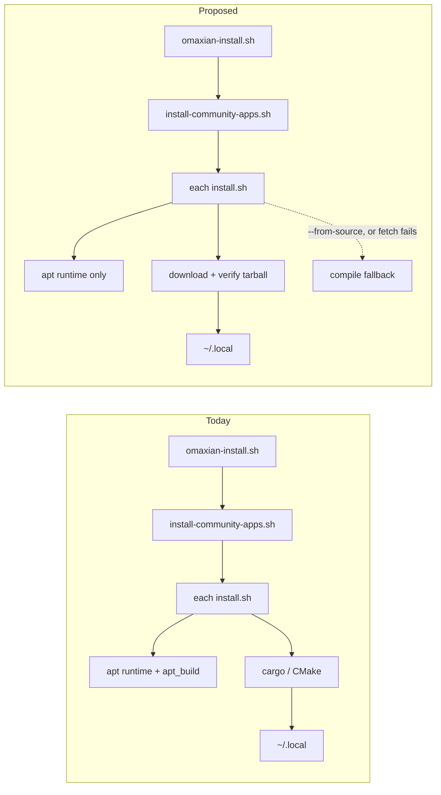

# Community apps: pre-built packages

Status: implemented; the CI workflow has not had its first run on GitHub yet.

- Shared installer logic: `community-apps/lib/prebuilt.sh` (`app_deps_read`,
  `prebuilt_fetch`). The manifest is `.omaxian-prebuilt`, as below, plus an
  optional `bin=` (path inside the tarball).
- disktree pins upstream `v0.11.0`. Every other app builds from source until
  `.github/workflows/community-apps.yml` (scripts in `.github/scripts/`)
  publishes its binary and the pin PR is merged.
- Release tag: one `apps-<sha7>` per workflow run. Tarball:
  `<app>-<sha7>-x86_64-linux.tar.gz`, one directory holding the binary.
- Added beyond the plan: a CI job that installs only the runtime packages in
  a clean trixie and fails on unresolved libraries. Reading the CMake files
  already showed two gaps, now added to `apt`: `libturbojpeg0` (Monologue)
  and `libglib2.0-0t64` (Folio).
  `install.sh` also falls back to source when `<app>/` has local edits.

## Verdict

Pre-built packages fit the current design. Every community app already
installs as a user-local binary under `~/.local` (`bin`, `share/applications`,
icons). Whether the binary is downloaded or built on the user's machine is an
installer choice, not an architecture change.

Today all 9 apps compile on the user's machine by default. Only Meeting
Recorder has a download mode (`install.sh --binary`, upstream release tarball).



## Format

GitHub Release tarballs, not `.deb`, AppImage or Flatpak:

- They match the existing `PREFIX=$HOME/.local` contract and the i3/desktop
  glue the installers already write.
- No apt repository to maintain while the apps stay opt-in and unsandboxed.
- Flatpak and AppImage conflict with Omarchy theme paths and portals. `.deb`
  can come later.

### Tarball contents: the compiled binary only

Every `install_files` already reads `.desktop` files, icons, fonts and Folio's
plugins from the source tree (`$ROOT`). Folio's `plugins/` are shell scripts
and JSON, copied with `cp -a "$ROOT/plugins/."`. So a tarball holds only the
build output (`build/<name>`, or `target/release/<name>` for Rust), and the
installer keeps taking everything else from the checkout.

Because the binary and the data files come from different places, each
artifact must record the tree commit it was built from (see
[Manifest](#manifest)).

### Hosting

Omaxian's own GitHub releases, not upstream's, for every app that carries
Omaxian patches. Upstream artifacts are only usable as-is when the Omaxian
changes are packaging-only (disktree today).

The repo has no root `.github/` directory. The `community-apps/*/.github/`
workflows are upstream's and do not run here. The CI job is new work.

## Qt compatibility

The seven Qt Quick apps (Monologue, Signed, Plain, Omacalc, Omacut, Omawrite,
Folio) link the system Qt dynamically. None of them link Qt's private modules.

Qt 6 binaries run on the Qt minor they were built against **or newer**, never
older. The rule is: **build against the oldest Qt we support, Qt 6.8.**

- Devuan Excalibur is based on Debian trixie (Qt 6.8). A `debian:trixie`
  container job on a standard GitHub runner is enough. No Excalibur runner is
  needed.
- Do not use bookworm (Qt 6.4) or Ubuntu runners' own Qt.
- The installers do not refuse a mismatched Qt. When apt's Qt candidates do not
  match the installed `libqt6core6t64`, they skip those packages and fall back
  to `~/.local/opt/omaxian-qt6-<mm>/` and to wrapper scripts that load QML from
  `~/.local/lib/qt6/qml` (see `community-apps/plain/install.sh`). The binary
  install path must keep the `needs_qml_wrapper` / wrapper logic. That is a
  runtime concern and applies to downloaded binaries too.
- If the installed Qt is older than 6.8, the download path must fall back to
  building from source.

### Architecture

First cut: x86_64 only. The installers contain 36 hard-coded
`/usr/lib/x86_64-linux-gnu` paths. aarch64 keeps building from source until
those paths are made arch-aware.

## Per-app effort

| App | Source of the binary | Effort | Notes |
| --- | -------------------- | ------ | ----- |
| disktree | Upstream release (`disktree-<ver>-x86_64-linux.tar.gz` + `.sha256`, built on ubuntu-22.04) | Lowest | Omaxian deltas are packaging-only. Install skips rustup and the musl targets. |
| Qt Quick apps (7) | Omaxian CI, `debian:trixie` | Medium | One shared CMake job. Keep the QML wrapper logic. |
| Meeting Recorder | Omaxian CI, `debian:trixie` | Medium | Upstream binaries lack the Omaxian bar-enable patch. GTK4/libadwaita link dynamically, so it must also be built on trixie. Check that today's `--binary` runs on Excalibur before relying on it. CI needs `glslc` for the Vulkan whisper backend. |

## Manifest

One small file per app, next to `.omaxian-upstream-commit`, for example
`.omaxian-prebuilt`:

```text
url=https://github.com/aozora/omaxian/releases/download/apps-<tag>/<name>-<ver>-x86_64-linux.tar.gz
sha256=<hex>
tree=<omaxian commit the binary was built from>
```

- The expected sha256 lives **in the repo** and is checked before extraction.
  A `.sha256` file downloaded next to the tarball proves nothing on its own.
  Today's Meeting Recorder `fetch_binary` does no check at all.
- `tree=` ties the binary to the data files. CI rebuilds an app whenever its
  directory changes and rewrites the manifest in the same change, so a new
  binary never pairs with old data files or the reverse.

## Changes

### 1. CI (new root workflow)

- `.github/workflows/community-apps.yml`, `debian:trixie` container, x86_64.
- Build each app with its existing `bin/build` / CMake / cargo step.
- Package the binary as `<name>-<ver>-x86_64-linux.tar.gz`, upload to a
  release, and open a PR that updates each `.omaxian-prebuilt`.
- Trigger on changes under `community-apps/<app>/` (path filters) plus manual
  dispatch.

### 2. Per-app `install.sh`

- Default: read `.omaxian-prebuilt`, download, verify sha256, extract into a
  temporary directory, then hand the binary to the existing `install_files`.
- `--from-source`: today's build path. Meeting Recorder's `--binary` becomes
  the default and stays accepted as a no-op alias.
- **Automatic fallback** to source, with a message, when: there is no manifest,
  the architecture is not x86_64, the download or checksum fails, or the
  installed Qt is older than 6.8.
- Install only runtime packages on the binary path. Install `apt_build` only
  when compiling (including the fallback).
- Read the package lists from `omaxian.deps.json` instead of the hard-coded
  `apt_runtime` / `apt_build` arrays, which duplicate the JSON today and can
  drift from it.

### 3. Helper and TUI

- `scripts/install-community-apps.sh`: pass `--from-source` through, like
  `--skip-apt`.
- `omaxian-install.sh`:
  - The helper runs without `--skip-apt`, so each `install.sh` installs its own
    packages. Changing only the confirm dialog's list is not enough; step 2 is
    what actually stops build packages from being installed.
  - `confirm_app_deps`: list `apt` only for the default path and add
    `apt_build` when the user picks source builds. Fix the closing text
    ("Each selected app will build…").
  - Offer a "Build from source" choice in the apps step.

### 4. Docs

- `community-apps/README.md` and each app's README: binary default,
  `--from-source`, automatic fallback, x86_64-only prebuilts, and the
  "built against Qt 6.8, runs on 6.8+" rule.
- `docs/omaxian/install-scripts.md`: the TUI's source-build option.

## Order

1. **disktree first.** Upstream artifact plus a pinned checksum. This proves
   the manifest, fetch, verify, fallback and TUI pieces without any CI work.
2. Helper / TUI changes (step 3), together with step 2 for disktree.
3. CI workflow, starting with one Qt app (Omacalc is the smallest).
4. The remaining Qt apps, then Meeting Recorder.
5. Docs, updated along with each step.

## Not needed

- Rewriting apps as shell plugins
- Changing deploy or `$OMARCHY_PATH`
- Bundling a private Qt (possible later for portability)
- System-wide `/usr` packages for the first cut
